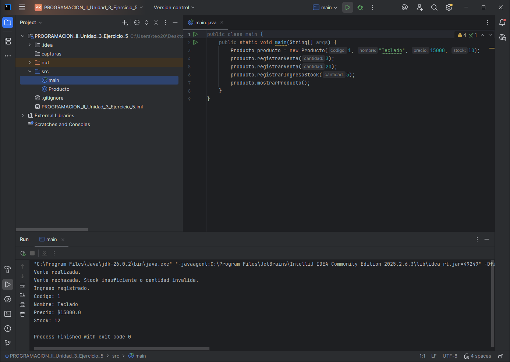

# PROGRAMACIÓN II — Unidad 3, Ejercicio 5: El Inventario de Productos y Stock Protegido

Trabajo práctico de Programación II. Este repositorio contiene la resolución en Java del ejercicio 5 de la Unidad 3.

## Consigna

#### Contexto

En un sistema de comercio electrónico, el stock de un producto es un recurso crítico que no puede quedar en números negativos bajo ninguna circunstancia. El encapsulamiento protege el inventario frente a operaciones de venta o reabastecimiento desacertadas.

#### Consigna

Diseñar un modelo orientado a objetos que administre el stock de un artículo comercial mediante atributos privados y métodos que garanticen la integridad de las cantidades.

#### Desarrollo requerido

- Crear la clase Producto con atributos privados codigo, nombre, precio y stock.
- Desarrollar métodos públicos de control como registrarIngresoStock(int cantidad) y registrarVenta(int cantidad), asegurando que la venta no se efectúe si la cantidad solicitada supera el stock disponible.
- Ocultar el atributo stock directo mediante el uso exclusivo de getters para su lectura.
- En el método main, instanciar un producto, simular operaciones de venta exitosas y fallidas por falta de stock, y mostrar el estado final por consola.

## Estructura del repositorio

```
PROGRAMACION_II_Unidad_3_Ejercicio_5/
├── README.md
├── capturas/
│   └── consola.png
└── src/
    ├── main.java   # clase con el método main
    └── Producto.java
```

## Funcionamiento y lógica

El ejercicio aplica **encapsulamiento** sobre el stock de un producto, que solo se modifica con ventas e ingresos validados.

### `Producto`

Tiene los atributos privados `codigo`, `nombre`, `precio` y `stock`.

- **Constructor:** guarda los datos y el stock inicial solo si no es negativo.
- **`registrarIngresoStock(int)`:** suma unidades solo si la cantidad es positiva.
- **`registrarVenta(int)`:** descuenta unidades solo si la cantidad es positiva y hay stock suficiente; si no, rechaza la venta.
- **`mostrarProducto()`:** imprime todos los datos del producto.

### `main`

Crea un **Teclado** a $15000 con 10 unidades:

1. Vende 3 → quedan 7.
2. Intenta vender 20 → rechazado por stock insuficiente.
3. Ingresan 5 → quedan **12**.

Al final se muestran los datos del producto.

## Ejecución

Captura de la consola de IntelliJ IDEA ejecutando el programa:



Salida obtenida:

```
Venta realizada.
Venta rechazada. Stock insuficiente o cantidad invalida.
Ingreso registrado.
Codigo: 1
Nombre: Teclado
Precio: $15000.0
Stock: 12
```
